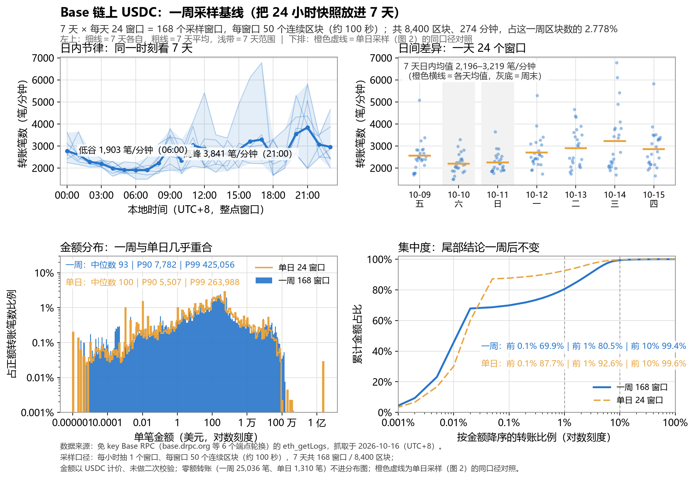
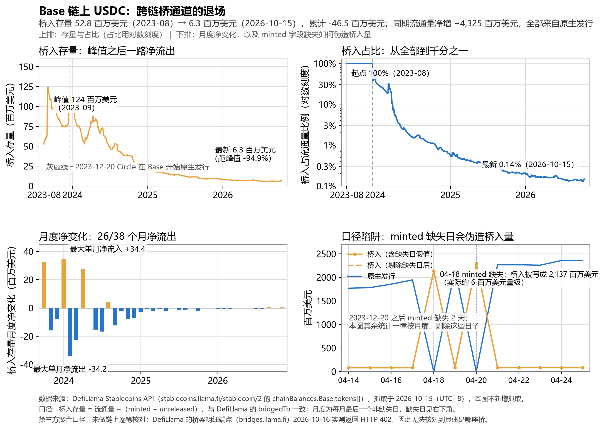
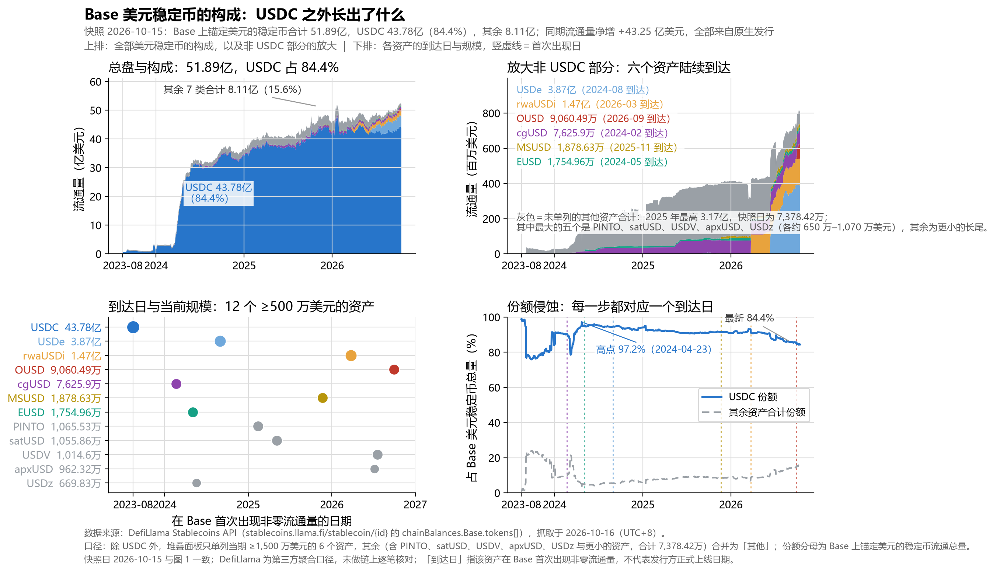
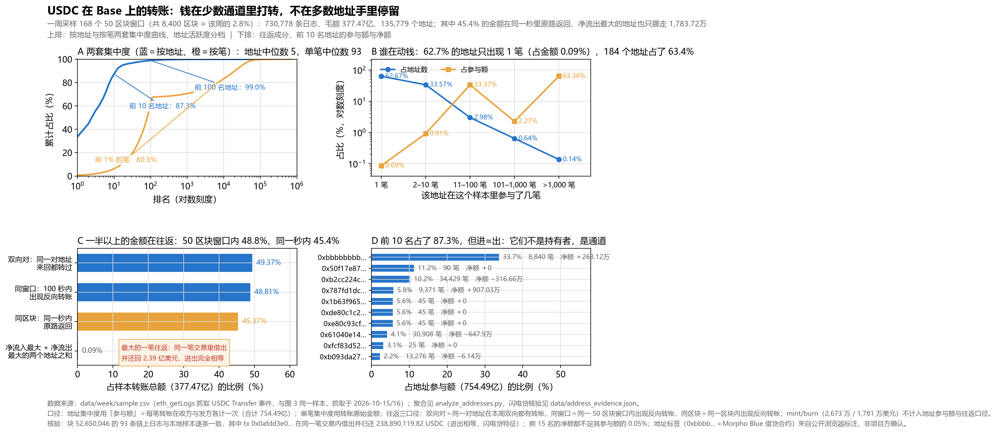

# Base 链上 USDC：规模、份额与转账活动

作品集六张图。数据全部来自免费的公开接口：DefiLlama Stablecoins API（免 key）与 Base 公共 RPC（免 key），脚本可复现。配套技术文：[中文 `article.md`](article.md) · [English `article.en.md`](article.en.md)。

| 图 | 看什么 | 数据源 |
| --- | --- | --- |
| 图 1 | 存量：Base 上 USDC 的规模、构成与份额（2023-08 – 2026-10 日度） | `stablecoins.llama.fi` |
| 图 2 | 流量：24 小时采样窗口内的转账笔数、金额分布与集中度 | Base RPC `eth_getLogs` |
| 图 3 | 基线：把 24 小时快照放进 7 天（168 个采样窗口）的日内节律，以及集中度与天量转账的复核 | Base RPC `eth_getLogs` |
| 图 4 | 通道：跨链桥入的 USDC 存量如何一路净流出，以及 `minted` 缺失日造出的假值 | `stablecoins.llama.fi` |
| 图 5 | 分母：Base 美元稳定币的构成里，USDC 之外的资产什么时候出现、现在多大 | `stablecoins.llama.fi` |
| 图 6 | 地址：同一份转账样本换到「地址」口径——两套集中度、活跃度分档、往返成分与前 10 名地址 | Base RPC `eth_getLogs` |

---

## 图 1 · 流通量与市场份额


- **规模**：Base 上的 USDC 流通量从 2023-08-16 的 0.53 亿美元升到 2026-10-15 的 43.8 亿美元（约 83 倍）；峰值 47.7 亿美元（2026-01-22），此后回落约 8%。
- **结构**：2023-12-20 Circle 在 Base 上开始原生铸造之前，链上 USDC 全部靠跨链桥入；现在 43.72 亿美元是原生铸造，桥入只剩 632 万美元（0.14%）。
- **份额**：USDC 占 Base 上锚定美元的稳定币流通量的 84.4%（2026-10-15），高点为 97%（2024-04-23）。份额下滑不是 USDC 变少，而是分母里长出了别的美元稳定币。
- **当期构成**（2026-10-15 抓取）：USDC 43.89 亿、USDe 3.87 亿（7.5%）、rwaUSDi 1.47 亿、OUSD 0.90 亿、cgUSD 0.76 亿。

口径：

| 项 | 说明 |
| --- | --- |
| 端点 | `/stablecoins?chain=Base`（当期快照）、`/stablecoin/2`（USDC 分链历史）、`/stablecoincharts/Base`（Base 全链历史） |
| 频率 | 日度，UTC 零点；本图覆盖 2023-08-16 – 2026-10-15，共 1157 个点 |
| 流通量 | `circulating = minted − unreleased + bridgedTo`；图中把 `minted − unreleased` 记为「原生铸造」、其余记为「跨链桥入」，两段相加严格等于 `circulating`（脚本内有断言自检） |
| 份额 | USDC 在 Base 的流通量 ÷ Base 上所有 `peggedUSD` 稳定币的流通总量 |

---

## 图 2 · 转账活动（24 小时采样）


**采样口径**：以 2026-10-15 12:48Z（北京 20:48）链头为锚，往前每小时抽 1 个窗口、每窗口 50 个连续区块（1.63 分钟），共 24 窗口 / 1200 区块 / 93,656 条 Transfer 日志，占这 24 小时区块数的 2.8%。区间为 2026-10-14 12:48Z – 10-15 12:48Z。

- **笔数**：实测区间 1,710 – 3,616 笔/分钟，均值 2,387 笔/分钟。最低在北京时间 10-15 03:48，最高在 10-14 21:48。
- **金额分布**：中位数 100 美元、P90 5,498 美元、P99 263,797 美元、最大单笔 2.36 亿美元——跨度 6 个数量级。另有 1,310 笔金额为 0（同一批次里的尘埃/测试转账不做清理，单独报数）。
- **小额长尾**：17,200 笔不足 1 美元，占全部转账的 18.4%。用中位数描述 USDC 的转账毫无意义，长尾才是主体。
- **集中度**：按金额降序，前 0.1% 的转账占 87.7% 的金额，前 1% 占 92.6%，前 10% 占 99.6%。这是一天的口径；一周基线（图 3）把「前 1%」修正为 80.5%，指标的绝对水平由极少数天量往返决定，宜读作区间。
- **地址**：13,159 个发送地址 / 12,158 个接收地址；最大的一个发送地址占 4.7% 的转账笔数，前 10 名发送方里有 6 个同时出现在头部接收方名单——做市/路由的往返特征。
- **铸造与销毁**：93,390 笔为普通转账，另有 mint 130 笔（合计 286 万美元）与 burn 136 笔（合计 181 万美元）。作者按同一窗口口径对比：采样窗口内原生增发的金额只占转账金额（70.5 亿美元）的 0.04%。

### 这张图是怎么拿到的

`eth_getLogs` 有单次结果上限：实测请求 100 个区块会被拒（`query exceeds max results 20000`），50 个区块返回约 1.2 万条日志。免费端点的真实瓶颈是带宽（约 0.4 MB/s）而不是速率限制，跑完 24 个窗口约 60 MB、200 秒。

免费端点会累积限流：`base-rpc.publicnode.com` 在累计约 200 MB 查询量后开始稳定返回 `HTTP 403`，退避重试无效。脚本因此改为**端点池轮换 + 被拒端点冷却 90 秒**，24 个窗口最终由 `base.drpc.org` 单点完成。

---

## 图 3 · 一周基线（把 24 小时快照放进 7 天）



**采样口径**：沿用图 2 的密度——每小时 1 个窗口、每窗口 50 个连续区块（约 100 秒），连续抽 7 天，共 168 窗口 / 8,400 区块 / 274 分钟，占这一周区块数的 2.778%；覆盖 2026-10-09 01:35Z – 10-16 02:04Z。抓取量 730,778 条日志、441 MB 出网、1,082 秒 RPC 时间、0 次服务端重试。

- **日内节律**：7 天平均口径下，北京时间 06:00 最低（1,903 笔/分钟）、21:00 最高（3,841 笔/分钟）。7 天各自的曲线都在这条节律上下摆动，没有一天出现量级性偏离。
- **日间差异**：7 天的日内均值落在 2,196 – 3,219 笔/分钟之间；周末（10-10、10-11）并不比工作日低，按这个样本看不出周末效应。
- **金额分布形状不变**：一周口径下中位数 93 美元、P90 7,782 美元、P99 425,056 美元、最大单笔 2.39 亿美元，与图 2 的单日曲线（中位数 100 美元）几乎重合。稳健统计量跨样本稳定，极值统计量不稳定。
- **集中度修正**：一周口径下前 0.1% 占 69.9%、前 1% 占 80.5%、前 10% 占 99.4%。图 2 的「前 1% 占 92.6%」不是常态：同一份一周数据按单日的「前 1%」笔数（923 笔）折算，前 1% 只有 70.4%；两边的差别来自被抽中的时段，不是市场变化。
- **天量转账是往返搬运**：一周样本里金额 ≥ 100 万美元的 1,120 笔转账（合计 267.9 亿美元，占全部金额 71.0%）**全部**能在样本内找到同一秒、等额、反向的另一笔；参与地址只有 41 个，其中 `0xbbbbbbbbbb9cc5e90e3b3af64bdaf62c37eeffcb` 一个地址转出 127.2 亿美元（该地址的身份未在本研究中核实）。这类往返净额为零，意味着用金额口径衡量「资金流动」会把搬运记成转移。

---

## 图 4 · 跨链桥这条通道的退场



**口径**：桥入存量 = 流通量 −（`minted` − `unreleased`），与 DefiLlama 的 `bridgedTo` 字段一致；与图 1 同一份日度数据，本图不新增抓取。`minted` 字段在 2023-12-20 之后仍有 2 天缺失（2024-04-18、2024-04-20），缺失日会把整条流通量误记成桥入（那天「桥入」写成 21 亿美元，真实量级约 8,300 万），因此除右下角案例外，所有统计都剔除缺失日、并按月度取每月最后一个有效日。

- **退场**：桥入存量 2023-08-16 是 5,280 万美元，2023-09-04 冲到 1.243 亿美元峰值，此后 38 个月里 26 个月净流出，到 2026-10-15 只剩 632 万美元，比峰值低 94.9%。
- **占比**：桥入占流通量的比例从 100%（2023-08，当时还没有原生铸造）降到 0.14%（2026-10-15）。同期流通量净增 43.25 亿美元、原生净增 43.72 亿美元——这条通道退场的同时，规模的增长全部由原生发行承担。
- **净变化**：月度桥净变化最大单月净流入 3,441 万美元（2023-12，与 Circle 原生发行同月），最大单月净流出 3,418 万美元（2024-01）。
- **拿不到的东西**：DefiLlama 的桥梁明细端点（`bridges.llama.fi`）2026-10-16 实测返回 HTTP 402，无法核对到具体是哪座桥，本图只描述通道层面的存量变化。

---

## 图 5 · 分母里长出了什么（Base 美元稳定币的构成）



**口径**：按资产 id 取 `stablecoins.llama.fi/stablecoin/{id}` 的 `chainBalances.Base.tokens[]`，快照日与图 1 对齐（2026-10-15）。除 USDC 外只单列当期 ≥1,500 万美元的 6 个资产，其余合并为「其他」。

- **总盘**：Base 上锚定美元的稳定币合计 51.89 亿美元，其中 USDC 43.78 亿（84.4%），其余合计 8.11 亿（15.6%）。
- **追赶者都是最近两年才出现的**：cgUSD 2024-02、EUSD 2024-05、USDe 2024-08、MSUSD 2025-11、rwaUSDi 2026-03、OUSD 2026-09。现在规模最大的是 USDe 3.87 亿（占总量 7.45%），其次 rwaUSDi 1.47 亿（2.84%）、OUSD 9,060 万（1.75%）。
- **拆开看这份份额下滑**：USDC 从 97.2%（2024-04-23）降到 84.4%，一共 12.8 个百分点。其中 USDe 一个占 7.4 个点，2026 年才出现的 rwaUSDi 与 OUSD 合计 4.6 个点，其余 6 个资产与长尾分掉不到 1 个点。份额的对手不是一个币，而是一串在不同时间点出现的资产。
- **长尾一直在 3–4% 上下**：「其他」（未单列的资产）2025 年最高 3.17 亿美元，2026-10-15 为 7,378 万美元；其中最大的五个是 PINTO、satUSD、USDV、apxUSD、USDz（各约 650 万–1,070 万美元）。这些名字在 2024 年的数据里还不存在。

---

## 图 6 · 换个口径：钱在少数通道里打转（地址维度）



**样本**：与图 3 完全相同的一周采样（168 个 50 区块窗口、730,778 条日志、毛额 377.47 亿美元、135,779 个地址），只换统计口径。

- **两套集中度**：按地址的参与额（每笔转账在收方与发方各计一次，合计 754.49 亿）前 10 名占 87.3%、前 100 名占 99.0%；按单笔金额前 1%（7,307 笔）占 80.5%、前 100 笔占 62.4%。两个口径的基尼系数为 0.9998 与 0.9844，中位数为 5 美元与 92.82 美元——地址口径几乎没有中间层。
- **活跃度**：135,779 个地址里 62.7% 只出现 1 笔（合计只占 0.09% 的金额）；184 个地址（0.14%）占了 63.4% 的参与额；11–100 笔这档的 4,050 个地址占 33.4%。
- **一半以上的金额在往返**：49.4% 的金额能在同一对地址之间找到反向记录，48.8% 在同一 50 区块窗口（约 100 秒）内出现反向，45.4% 在同一秒（同一区块）里原路返回。对应的净额极小：最大净流入 1,500.00 万美元、最大净流出 1,783.72 万美元，两者相加只占毛额的 0.09%。
- **前 10 名不是持有者，是通道**：0xbbbb…（公开浏览器标注为 Morpho Blue 借贷合约）8,840 笔、占参与额 33.7%，净额 +263.1 万美元；0xb2cc224c… 34,429 笔、10.2%，净额 −316.7 万美元；前 15 名的净额都不足各自参与额的 0.05%。
- **链上核验**：样本里最大的一笔往返在块 52,650,046——同一笔交易（tx `0x0afdd3e0…`）里 Morpho Blue 转出 238,890,119.82 USDC 又收回等额，零费用闪电贷的典型形态；该块 93 条链上日志与本地样本逐条一致（原样记录在 `data/address_evidence.json`）。

---

## 文件

```
fetch_data.py                 图 1：抓 DefiLlama 三个端点 → data/*.json + data/*.csv
make_figure.py                图 1：读 CSV 出图 → figures/base_usdc.{png,svg,pdf}
fetch_transfers.py            图 2：采样 eth_getLogs，可断点续跑（已存在的窗口跳过）
                              抓取阶段 → data/windows/plan.json + data/windows/wNN.json
                              汇总阶段 → data/transfers_windows.csv / transfers_sample.csv / transfers_summary.json
make_transfer_figure.py       图 2：读上述产物出图 → figures/base_usdc_transfers.{png,svg,pdf}
probe_rpc_list.py             一次性调查：逐个试公共端点，记录可用性与单窗口条数
probe_transfers.py            一次性调查：测 eth_getLogs 的区块上限与带宽
data/usdc_base_daily.csv      USDC 在 Base 的逐日流通量（拆原生铸造 / 跨链桥入）
data/base_stablecoins_daily.csv  Base 全链稳定币逐日流通量（份额分母）
data/base_stablecoins_now.csv    Base 各稳定币当期流通量
data/transfers_windows.csv    逐窗口统计（24 行，含笔数/金额分位/独立地址数/最大发送方占比）
data/transfers_sample.csv     逐笔转账（93,656 行：时间戳、区块、from、to、金额、类型）
data/windows/plan.json        采样锚点（链头 52,639,572、参考块、块速），随仓库提供
data/windows/wNN.json         每个窗口的原始日志（约 13 MB，未纳入版本库，重跑 fetch_transfers.py 即重建）
fetch_transfers_week.py       图 3：7 天 × 24 窗口采样（密度同图 2），自带汇总，可断点续跑
                               抓取阶段 → data/week/plan.json + data/week/wNNN.json（168 个，未纳入版本库）
                               汇总阶段 → data/week/*.csv + summary.json + sample.csv（91 MB，未纳入版本库）
make_week_figure.py           图 3：读 data/week/*.csv 与单日 sample 出图 → figures/base_usdc_week.{png,svg,pdf}
analyze_roundtrips.py         图 3 的补充分析：统计「同秒、等额、反向」的镜像往返占金额的比例
make_bridge_figure.py         图 4：只读 data/usdc_base_daily.csv 出图（不新增抓取）→ figures/base_usdc_bridge.{png,svg,pdf}
fetch_composition.py          图 5：按资产 id 抓 Base 逐日流通量（12 个 ≥500 万美元的资产）→ data/base_composition.csv
make_composition_figure.py    图 5：只读上述 CSV 与图 1 的两份 CSV 出图 → figures/base_usdc_composition.{png,svg,pdf}
data/base_composition.csv     各资产逐日流通量（date, symbol, usd），随仓库提供
data/composition_meta.json    图 5 抓取元信息（快照日、阈值、各资产 id 与到达日）
analyze_addresses.py          图 6：把 data/week/sample.csv 聚合到地址口径 → data/address_stats.json + address_curve.csv
make_address_figure.py        图 6：只读上述两份产物与 address_evidence.json 出图 → figures/base_usdc_addresses.{png,svg,pdf}
data/address_stats.json       图 6 聚合结果（样本、两套集中度、活跃度分档、往返口径、净额榜、前 15 名地址）
data/address_curve.csv        图 6 集中度曲线采样点（basis×kind：按地址/按笔、线性份额/对数排名）
data/address_evidence.json    图 6 的链上核验记录（块 52,650,046 的闪电贷同笔交易与逐条比对结果）
data/week/week_hourly.csv     7 天 × 24 小时的笔数节律（逐小时均值 / 最大 / 变异系数）
data/week/week_hist_amount.csv    一周金额分布（0.05 个数量级一箱）
data/week/week_concentration.csv  一周集中度曲线（rank_pct / cum_value_share）
data/week/transfers_windows.csv   168 个窗口的逐窗口统计
data/week/summary.json        一周汇总（类型计数、分位数、覆盖度），随仓库提供
data/week/plan.json           一周采样锚点（链头 52,663,468、参考块、块速），随仓库提供
```

仓库里包含出图与文章直接读取的全部数据（含 `transfers_sample.csv`，93,656 行逐笔记录），不包含两类抓取中间产物：`data/raw_*.json` 与 `data/windows/w*.json`——它们体积大、内容与上表重复，跑一遍抓取脚本即可重新获得。

复现：

```bash
python fetch_data.py
python make_figure.py
python -u fetch_transfers.py          # 需要约 60 MB 出网带宽、200 秒
python -u make_transfer_figure.py
python -u fetch_transfers_week.py     # 7 天 × 24 窗口基线，需要约 440 MB、约 20 分钟
python -u make_week_figure.py
python -u analyze_roundtrips.py       # 镜像往返占比（需 data/week/sample.csv）
python -u make_bridge_figure.py       # 图 4：只读已有 CSV，不新增抓取
python -u fetch_composition.py        # 图 5 数据：12 次请求，约 1 分钟
python -u make_composition_figure.py  # 图 5
python -u analyze_addresses.py        # 图 6 数据：聚合一周样本（需 data/week/sample.csv）
python -u make_address_figure.py      # 图 6
```

依赖：Python 3 + pandas + matplotlib（本机 Python 3.14.4 / matplotlib 3.11.1 / pandas 3.0.5 实测通过）。两个抓取脚本只用标准库，不需要任何 API key。

## 已知限制

- DefiLlama 是第三方聚合口径，未做链上逐笔核对；图 1 的数字只能算「该 API 的口径」。
- 图 1 里 `minted`、`unreleased` 两个字段 2023-12-20 起才有；此前按「全部为跨链桥入」处理，与该日 `circulating == bridgedTo` 的事实一致。份额分母只含 DefiLlama 标记为锚定美元的资产，不含 EUR/ARS 等其他锚定币。
- 图 2 是 2.8% 的区块抽样，且窗口是连续的 50 块，只能代表被抽中的时段；没有做日内分层加权，也没有按小时区分工作日与周末。
- 图 2 的地址数按字面去重，未区分 EOA 与合约、未做同一实体的归并；集中度同时给出「按笔」与「按地址」两个口径（后者见图 6）。
- 图 2 的金额按 USDC 计价、1e6 精度还原，未做二次校验；mint/burn 只反映 Circle 的原生发行与回收，跨链桥入的 USDC 在链上表现为普通转账。
- 图 3 的一周基线同样只覆盖该周区块数的 2.778%，而且每天的窗口都落在同一分钟偏移（每小时 :35），可能系统性地错过别的分钟；图中日内节律是 7 天平均的结果，不等于任何单独一天。
- 图 3 的「同秒、等额、反向」匹配只在样本内做，另一半若落在采样窗口之外就发现不了，因此 71.0% 是这类往返占比的下界。
- 图 3 里出现的 41 个大额地址，其链下归属没有独立证据（没有做标签库对照），文中只描述行为，不断言身份。
- 图 4 的桥入存量取自 DefiLlama 的 `bridgedTo` 拆分，同样是第三方聚合口径；桥梁明细端点 2026-10-16 返回 HTTP 402，无法确认具体是哪座桥。
- 图 4 的 `minted` 字段在 2024-04-18、2024-04-20 缺失，缺失日会把整条流通量误记为桥入；本图剔除这两天并取月度为口径，日度视图下这两天不可用。
- 图 5 的「到达日」是该资产在 DefiLlama 数据里首次出现非零流通量的日期，不等于发行方正式上线日期；小资产的历史可能被上游回填或修订。
- 图 5 的「其他」是「总量 − 已单列资产」的残差，会随上游分类调整；它包含已经退场的资产，但无法逐一点名。
- 图 6 与图 3 共用同一份 2.8% 抽样，往返比例因此是下界：对端若落在采样窗口之外就看不见。图 6 的「参与额」把每笔转账在收方与发方各计一次，合计是毛额的 200%，不能与毛额直接比大小。
- 图 6 里的地址标签（如 0xbbbb…＝Morpho Blue 借贷合约）来自公开浏览器标注，不是项目方确认；闪电贷的判定依据是同一笔交易内借出与归还等额（块 52,650,046 的 tx `0x0afdd3e0…`），没有读取合约源码或事件日志之外的上下文。
