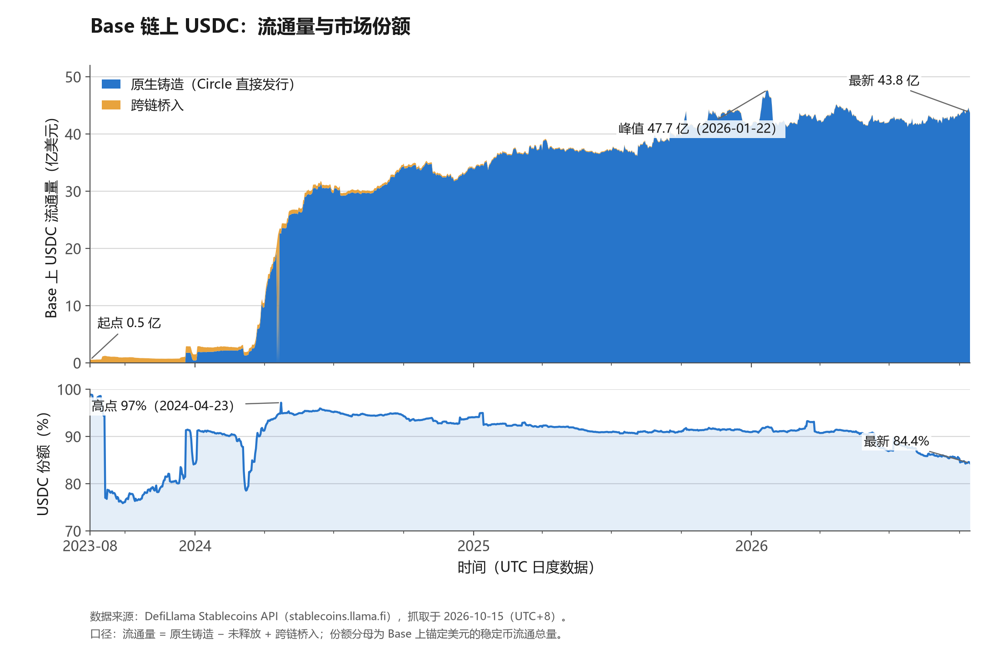
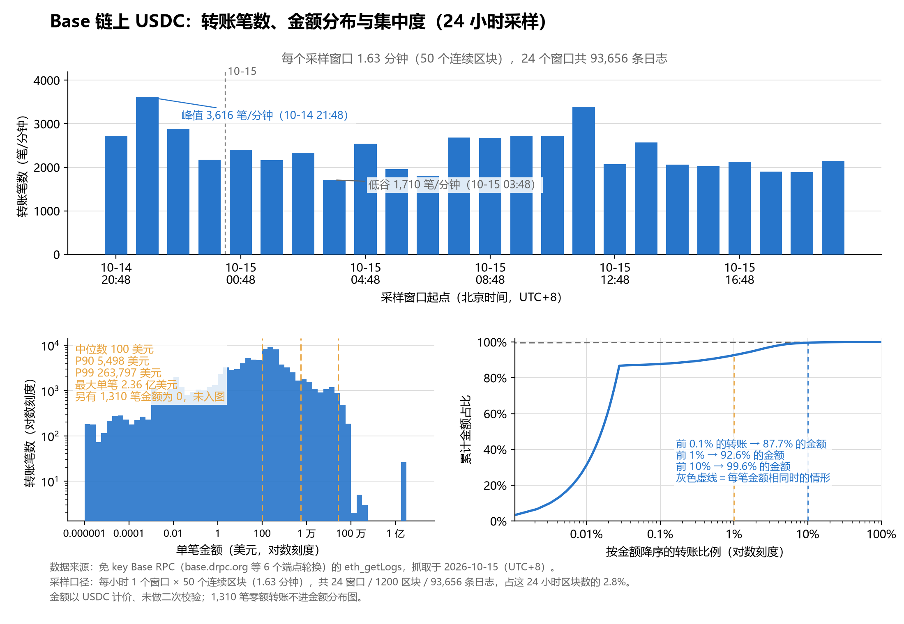

# USDC on Base: $4.38 Billion of Stock, and a One-Day Slice of Flow

*English version of [`article.md`](article.md). Numbers and definitions are identical in both.*

Base is Coinbase's Ethereum layer 2, and USDC is the main form of on-chain dollars there. Two questions shape the money on this chain: how much USDC is there and how did it get there, and how does that money move in a day.

This article answers both with two kinds of free interface: the DefiLlama stablecoin endpoints for daily stock, and the public Base RPC's `eth_getLogs` for transfer detail. Every number carries its source and definition, and the scripts in this repository reproduce them line by line.

## 1. Sources and definitions

| Source | Use | Measured 2026-10-15 |
| --- | --- | --- |
| `stablecoins.llama.fi/stablecoincharts/Base` | Daily circulating supply of all USD stablecoins on Base (share denominator) | no key needed, 1,158 daily records |
| `stablecoins.llama.fi/stablecoin/2` | USDC (asset id = 2) history by chain | no key needed, 1,157 daily records on Base |
| `stablecoins.llama.fi/stablecoins?chain=Base` | Current snapshot per stablecoin | no key needed, 57 assets with a USD peg |
| Public Base RPC (rotating across drpc / publicnode / 1rpc / Tenderly / BlastAPI / thirdweb) | USDC Transfer logs | no key needed; per-query result cap |

Both interfaces need no registration and no key. That is what sets the resolution this study can reach, and what it cannot.

**Stock definition**: `circulating = minted − unreleased + bridgedTo`. `minted − unreleased` is recorded as native mint, the rest as bridged in. Across 1,157 daily points, the two parts add back to `circulating` with a maximum error of 0.00e+00.

**Flow definition**: anchored at block 52,639,572 (2026-10-15 12:48Z), one window is drawn every hour going back, each covering 50 consecutive blocks (1.63 minutes): 24 windows / 1,200 blocks / 93,656 Transfer logs, 2.8% of the blocks in those 24 hours, spanning 2026-10-14 12:48Z to 10-15 12:48Z. Amounts are reconstructed from USDC's 6 decimals (`int(data,16)/1e6`); a `from` of the zero address counts as mint, a `to` of zero as burn, everything else as a plain transfer.

**Why 50-block windows**: `eth_getLogs` caps a single query at 20,000 results. A 100-block request is rejected in practice (`query exceeds max results 20000`), while 50 blocks return about 12,000 logs and leave margin. The real bottleneck on free endpoints is bandwidth (~0.4 MB/s), not rate limiting: the 24 windows came to 59.5 MB and 198 seconds.

**Endpoints throttle cumulatively**: `base-rpc.publicnode.com` starts returning `HTTP 403: Forbidden` consistently after roughly 200 MB of cumulative query volume, and backoff retries do not help. The script therefore rotates through a pool of endpoints and cools down any that rejects it for 90 seconds; all 24 windows in this run were ultimately served by `base.drpc.org` alone.

## 2. Stock: 83× growth, and one structural replacement



As Figure 1 shows, USDC on Base grew from $53 million on 2023-08-16 to $4.38 billion on 2026-10-15, about 83×; the peak of $4.77 billion came on 2026-01-22, followed by an 8% decline.

The growth was not smooth. The first jump came in March–May 2024: the $500M mark fell on 3-22, $1B on 3-28, $2B on 4-17 and $3B on 5-27. The $4 billion mark had to wait until 2025-09-16. In monthly net terms, April 2024 brought $1.393 billion in, the largest single month on record; May 2026 took $290 million out, the largest outflow.

Structurally, one replacement happened. Before 2023-12-20, all USDC on Base arrived over bridges; that day Circle began native minting on Base, and the `minted` field only exists from that date. By 2026-10-15, $4.372 billion is natively minted and only $6.32 million is bridged in, or 0.14%. The bridge route did not disappear; it went from being the only entrance to a rounding error.

Share is a separate story. USDC held 84.4% of USD-pegged stablecoin supply on Base on 2026-10-15, against a high of 97% (2024-04-23). The decline is not USDC shrinking — it kept growing over the same period — but the denominator growing new assets: USDe $387M, rwaUSDi $147M, OUSD $90M, cgUSD $76M. A single-asset curve misses this; the denominator has to be on the chart.

## 3. Flow: a 39-minute slice spanning six orders of magnitude



As Figure 2 shows, the 24 windows total 39.1 minutes; of the 93,656 logs, 93,390 are plain transfers, 130 are mints and 136 are burns.

**Rate** ranged from 1,710 to 3,616 transfers per minute, averaging 2,387. The low came at 03:48 Beijing time on 10-15, the high at 21:48 on 10-14. The whole curve oscillates inside a 2,000–3,000 band, with no change of magnitude.

**Amount distribution** is what the figure is really about. The median is $100, P90 $5,498, P99 $263,797, and the largest single transfer $236 million: six orders of magnitude. Another 17,200 transfers are under $1 (18.4% of the total) and 1,310 are exactly zero. The mean or the median of USDC transfers says nothing useful: the mean is dragged by a handful of large trades, and the median sits among the dust that bots move around.

**Concentration**: sorted by amount, the top 0.1% of transfers carry 87.7% of the value, the top 1% carry 92.6%, and the top 10% carry 99.6%. Addresses are just as concentrated: 13,159 senders and 12,158 receivers, with the largest sender accounting for 4.7% of all transfers, and six of the top ten senders also appearing among the top receivers. That is the signature of market makers and routers — the same addresses shuttling value, with no symmetry between count and amount.

**Mints and burns are nearly invisible by value**: 130 mints totalling $2.86 million and 136 burns totalling $1.81 million, just 0.04% of the $7.05 billion transferred in the same windows. Within the sample, USDC on Base moved between holders rather than being newly issued.

## 4. Reading the two figures together

$4.38 billion of stock, and $7.05 billion of transfers inside a 39.1-minute slice of it (same-window basis, no extrapolation). Stock and flow are different things: under this sampling definition, USDC on Base behaves more like a settlement medium than a store of value.

Three takeaways that transfer directly to other chains:

1. Metrics like "USDC transfer count" are inflated by small transfers: 18.4% of them are under $1. A count is only readable next to the amount distribution.
2. Value concentrates far more than count: the top 1% of transfers carries 92.6% of the value. To detect a change in flows, watch those head addresses rather than the total.
3. Falling share and growing size can hold at the same time; the denominator decides the share. An analysis that plots one asset will reach the opposite conclusion.

## 5. Limitations

- Figure 2 samples 2.8% of blocks, in contiguous 50-block windows, so it represents only the periods drawn; no intraday weighting was applied, and weekdays are not separated from weekends.
- Addresses are deduplicated literally: EOAs and contracts are not distinguished, and no entity-level merging was done. Concentration is ranked by transfer, not by address.
- Amounts are denominated in USDC and reconstructed from 6 decimals without a second check; mint and burn only reflect Circle's native issuance and redemption, while USDC arriving over a bridge appears on-chain as an ordinary transfer.
- Figure 1 rests on a third-party aggregation and was not reconciled trade by trade; the `minted` and `unreleased` fields only exist from 2023-12-20, and everything before that is treated as bridged in; the share denominator includes only assets DefiLlama flags as USD-pegged, excluding EUR and other pegs.
- Two self-checks from this work belong here as well. The histogram floor was once set to `floor(log10(max(min,1e-4)))`, which silently dropped every transfer below it; and a new variable collided with the bar-position variable, so `log10(0)` raised `ValueError: Maximum allowed size exceeded`. Both errors share one property: without the definition printed on the figure, neither is visible.

## 6. Reproducing

```bash
cd base-usdc
python fetch_data.py            # fetch three DefiLlama endpoints
python make_figure.py           # figure 1
python -u fetch_transfers.py    # sample Transfer logs, resumable per window, ~200 s / 60 MB
python -u make_transfer_figure.py   # figure 2
```

Requires Python 3 with pandas and matplotlib; the two fetch scripts use only the standard library. Verified on Python 3.14.4 / matplotlib 3.11.1 / pandas 3.0.5.

All interfaces were measured on 2026-10-15 (UTC+8). Figure 1 covers 2023-08-16 to 2026-10-15; Figure 2 covers 2026-10-14 12:48Z to 10-15 12:48Z.
